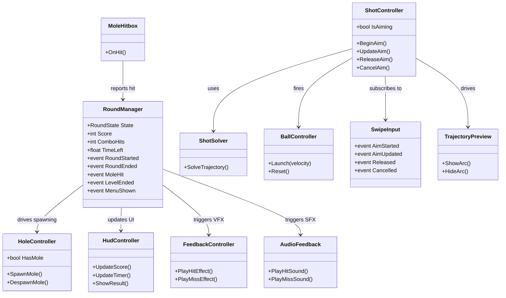
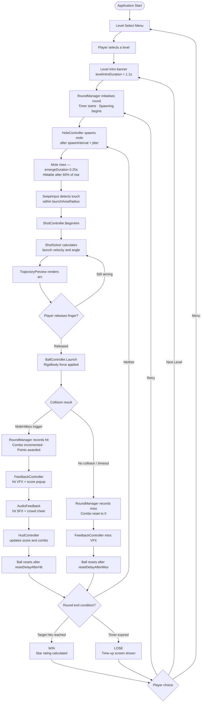
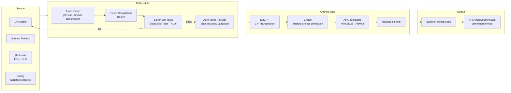

# Mole Shot — Football Mole Shooting Game

A 3D arcade mobile game built with Unity 6 and the Universal Render Pipeline. The player swipes to launch a football at moles popping up from burrows on a football field. The objective is to reach a hit target before the timer runs out, with a combo multiplier system that rewards consecutive hits.

**Platform:** Android (API 26+)  
**Engine:** Unity 6000.5.5f1  
**Version:** 0.1.0  
**Author:** Bhargav M — bhargav.m23@iiits.in  
**Institution:** IIIT Sri City

---

## Table of Contents

1. [Requirements](#requirements)
2. [Getting Started](#getting-started)
3. [Project Structure](#project-structure)
4. [Game Design](#game-design)
5. [Architecture Overview](#architecture-overview)
6. [Game Loop Pipeline](#game-loop-pipeline)
7. [Build Pipeline](#build-pipeline)
8. [Configuration Reference](#configuration-reference)
9. [Scripts Reference](#scripts-reference)
10. [Running Tests](#running-tests)
11. [Installing the APK](#installing-the-apk)

---

## Requirements

- Unity Hub with **Unity 6000.5.5f1**
- Android Build Support module (via Unity Hub Add Modules)
- Android SDK, NDK and JDK — bundled with Unity is sufficient
- Git

---

## Getting Started

```bash
git clone https://github.com/bhargavm-iiits/Mole-Shooting-Game.git
```

Open Unity Hub → **Add project from disk** → select the cloned folder. Unity will import all packages automatically on first open.

To run in the editor, open `Assets/Scenes/SampleScene.unity` and press Play. Mouse drag simulates swipe input.

To build for Android:

1. File → Build Settings → select **Android** → Switch Platform
2. Player Settings → Other Settings → Scripting Backend: **IL2CPP**
3. Build → select an output directory

---

## Project Structure

```
Football_mole/
├── Assets/
│   ├── Game Assets/
│   │   ├── football/            FBX model + diffuse/normal textures
│   │   ├── football-field/      GLB field model + ground textures
│   │   ├── mole/                GLB mole model + albedo texture
│   │   └── traffic-cone-low-poly/
│   ├── MoleShot/
│   │   ├── Art/                 Generated sprites, materials, mesh assets
│   │   ├── Config/              MoleShotConfig and LevelDefinition assets
│   │   ├── Prefabs/             Ball, Hole, Mole, HUD, Crowd prefabs
│   │   ├── Scripts/             All runtime C# scripts (see Scripts Reference)
│   │   │   └── Editor/          Editor-only tools: build, playtest, recorder
│   │   └── Tests/Editor/        NUnit tests for ShotSolver
│   ├── Scenes/
│   │   └── SampleScene.unity
│   └── Settings/                URP render pipeline assets (Mobile + PC)
├── APK/
│   └── MoleShooting.apk         Pre-built Android release
├── Packages/
│   └── manifest.json
└── ProjectSettings/
```

---

## Game Design

### Levels

There are three levels, each with a fixed duration and a hit target. Difficulty scales progressively within a level using an `AnimationCurve`.

| Level | Duration | Target Hits | Spawn Interval (start → end) | Fast Mole Chance |
|-------|----------|-------------|-------------------------------|------------------|
| 1     | 60 s     | 10          | 1.5 s → 1.1 s                 | 15% → 25%        |
| 2     | 90 s     | 15          | 1.3 s → 0.9 s                 | 20% → 30%        |
| 3     | 120 s    | 20          | 1.1 s → 0.75 s                | 30% → 40%        |

### Scoring

- Normal mole hit: **1 point**
- Fast mole hit: **2 points**
- Combo multiplier: every 3 consecutive hits increases the multiplier by 1, up to **3×**
- Missing resets the combo to 0

### Result

- Reaching the target hit count before the timer ends → **Win** (1–3 stars based on performance)
- Timer expires before the target is reached → **Time's up** (retry option)

---

## Architecture Overview

The game uses a component-based, event-driven design. `RoundManager` is the authoritative state machine. All other systems listen to its events rather than polling state directly.



---

## Game Loop Pipeline

Shows the full execution flow from player input through to round resolution.



---

## Build Pipeline

Shows how the project moves from source to a signed Android APK.



---

## Configuration Reference

All gameplay parameters are exposed in a single `MoleShotConfig` ScriptableObject at `Assets/MoleShot/Config/`. Key fields:

| Parameter | Default | Description |
|-----------|---------|-------------|
| `gravity` | 34 m/s² | Custom downward gravity applied to `Physics.gravity` and the trajectory preview |
| `launchAngle` | 28° | Fixed elevation angle for every shot |
| `maxRange` | 11.5 m | Ground distance reached at a full-length swipe |
| `minSwipe` | 0.045 | Minimum swipe length as a fraction of screen height |
| `fullSwipe` | 0.36 | Swipe length that maps to `maxRange` |
| `maxYaw` | 32° | Maximum horizontal aim angle either side of straight ahead |
| `shotTimeout` | 3 s | Unresolved shot after this duration counts as a miss |
| `hitsPerComboStep` | 3 | Consecutive hits per +1 multiplier |
| `maxMultiplier` | 3 | Multiplier cap |
| `holeCatchRadius` | 0.6 m | Ground impact within this radius of a hittable mole still counts as a hit |
| `targetFrameRate` | 60 fps | `Application.targetFrameRate` on Android |
| `physicsRate` | 60 Hz | `Time.fixedDeltaTime` and trajectory preview step rate |

---

## Scripts Reference

**Runtime**

| File | Responsibility |
|------|----------------|
| `RoundManager.cs` | Central state machine — level flow, timer, scoring, combo, mole spawning |
| `ShotController.cs` | Connects SwipeInput → ShotSolver → TrajectoryPreview → BallController |
| `ShotSolver.cs` | Computes launch velocity vector for a given target ground position |
| `BallController.cs` | Rigidbody wrapper — applies launch force, detects out-of-bounds, resets |
| `SwipeInput.cs` | New Input System adapter — raises `AimStarted`, `AimUpdated`, `Released`, `Cancelled` |
| `TrajectoryPreview.cs` | Simulates and draws the dotted arc during the aim phase |
| `HoleController.cs` | Manages a single burrow — mole spawn/despawn animation state machine |
| `MoleHitbox.cs` | Collider trigger on mole — calls `RoundManager` on a valid hit |
| `HudController.cs` | In-game UI: score counter, timer bar, combo label, result screen |
| `FeedbackController.cs` | Hit/miss particle effects, confetti, score popup |
| `AudioFeedback.cs` | SFX routing for all game events |
| `CrowdController.cs` | Procedural spectator animation — reacts to hit size |
| `CrowdCheerSynth.cs` | Synthesised crowd cheer audio |
| `LevelDefinition.cs` | Serialisable struct — per-level duration, target hits, difficulty ranges |
| `MoleShotConfig.cs` | Master ScriptableObject — all tunables |
| `MoleShotProgress.cs` | Persistent save data — best scores and stars per level |
| `AutoPlayer.cs` | Drives `ShotController` programmatically for automated playtest runs |
| `SafeAreaFitter.cs` | Adjusts UI RectTransform to the device safe area |
| `PortraitCameraFitter.cs` | Adjusts camera FOV for varying portrait aspect ratios |
| `Billboard.cs` | Rotates a transform to always face the camera |

**Editor-only**

| File | Responsibility |
|------|----------------|
| `MoleShotBuild.cs` | Menu item — one-click Android APK build |
| `MoleShotPlaytest.cs` | Runs `AutoPlayer` accuracy tests from the Editor menu |
| `MoleShotSceneBuilder.cs` | Procedural scene assembly helper |
| `MoleShotRecorder.cs` | Gameplay capture via `com.unity.recorder` |
| `ProceduralArt.cs` | Generates sprite/mesh assets used by the Art folder |

---

## Running Tests

The project includes NUnit tests for the trajectory solver. Run from the Unity Editor:

**Window → General → Test Runner → Edit Mode → Run All**

The `ShotSolverTests` suite validates that `ShotSolver` returns the correct launch velocity for a set of known target positions and gravity values.

---

## Installing the APK

A pre-built release APK is included at `APK/MoleShooting.apk`.

```
Minimum Android version: 8.0 (API level 26)
Architecture:            ARM64
Scripting backend:       IL2CPP
```

Installation steps:

1. Enable **Install unknown apps** for your file manager in Android Settings → Apps.
2. Transfer `MoleShooting.apk` to the device.
3. Open the file and tap **Install**.

---

## Dependencies

| Package | Version |
|---------|---------|
| Universal Render Pipeline | 17.5.0 |
| Input System | 1.19.0 |
| glTFast | 6.21.0 |
| Unity Recorder | 5.1.8 |
| Test Framework | 1.7.0 |
| Timeline | 1.8.12 |
| AI Navigation | 2.0.14 |
| Visual Scripting | 1.9.11 |
