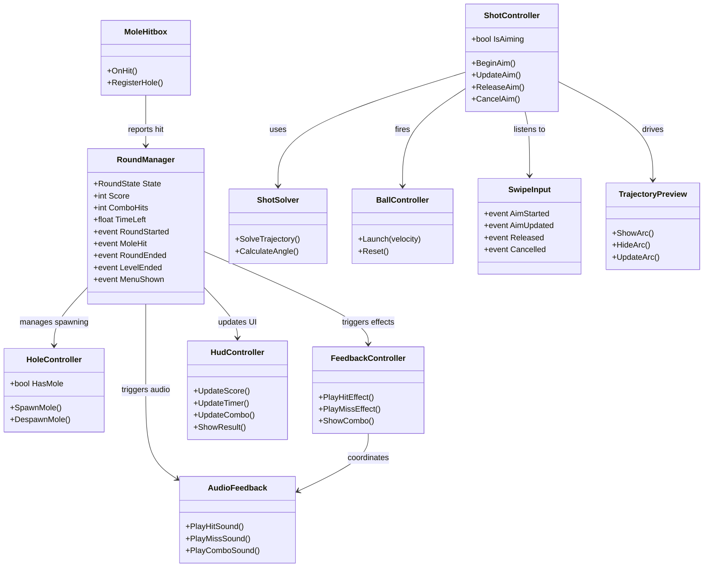
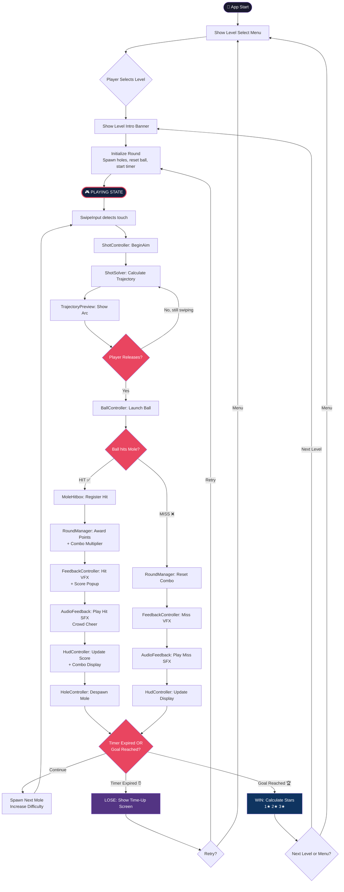
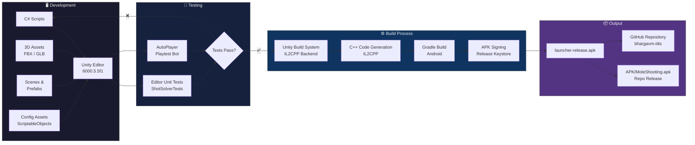

# ⚽🐭 Mole Shot — Football Mole Shooting Game

<div align="center">


**A fast-paced mobile football shooting game where you swipe to launch a ball at moles popping up from holes — score combos, beat the clock, and clear every level!**

[📱 Download APK](#-download--install) · [🎮 Gameplay](#-gameplay) · [🏗️ Architecture](#️-architecture) · [🔧 Setup](#-getting-started)

</div>

---

## 📋 Table of Contents

- [About the Game](#-about-the-game)
- [Gameplay](#-gameplay)
- [Features](#-features)
- [Tech Stack](#-tech-stack)
- [Project Structure](#-project-structure)
- [Architecture](#️-architecture)
- [Game Pipeline](#-game-pipeline)
- [Build Pipeline](#-build-pipeline)
- [Getting Started](#-getting-started)
- [Download & Install](#-download--install)
- [Scripts Reference](#-scripts-reference)
- [Contributing](#-contributing)

---

## 🎮 About the Game

**Mole Shot** is a 3D mobile arcade game built with **Unity 6** and the **Universal Render Pipeline (URP)**. Players swipe on the screen to aim and shoot a football at moles that pop up from burrow holes on a football field. The challenge is to hit enough moles to reach the score goal before the timer runs out — all while chaining combos for bonus multipliers.

> Developed as an assignment project for **IIIT Sri City** by **ImmersiWorks Prototype**.

---

## 🕹️ Gameplay

| Phase | Description |
|-------|-------------|
| **Menu** | Select a level from the level select screen |
| **Intro** | Level banner displays (can be skipped in debug mode) |
| **Playing** | Swipe to aim → release to shoot → hit moles for points |
| **Combo** | Chain hits without missing to multiply your score |
| **Win / Lose** | Reach goal before timer → Win (★★★); Time's up → Retry |

### Controls
- **Swipe** — drag to aim the trajectory arc, release to fire
- **Tap** — interact with UI buttons
- Touch-based input using Unity's new **Input System**

---

## ✨ Features

- 🎯 **Physics-based ball trajectory** with real-time preview arc
- 🐭 **Dynamic mole spawning** — difficulty scales per level config
- 🔥 **Combo multiplier system** — chain hits for 2×, 3×, 4× bonuses
- ⏱️ **Countdown timer** per round
- ⭐ **Star rating** (0–3 stars) based on performance
- 🔊 **Procedural crowd audio** — cheers react to your performance
- 📱 **Safe area & portrait fitting** for all Android screen sizes
- 🤖 **AutoPlayer** — AI-driven bot for playtesting shot accuracy
- 🎬 **Built-in recorder** for capturing gameplay footage (Editor only)
- 🎨 **URP rendering** with separate Mobile & PC render pipelines

---

## 🛠️ Tech Stack

| Technology | Version / Details |
|------------|-------------------|
| **Unity** | 6000.5.5f1 (Unity 6) |
| **Render Pipeline** | Universal Render Pipeline (URP) |
| **Input System** | Unity New Input System |
| **Platform** | Android (Min SDK 26 / Android 8.0+) |
| **Language** | C# (.NET) |
| **Physics** | Unity 3D Rigidbody Physics |
| **Build System** | Gradle (IL2CPP scripting backend) |
| **IDE** | Visual Studio / Rider |

---

## 📁 Project Structure

```
Football_mole/
├── 📁 Assets/
│   ├── 📁 Game Assets/           # 3D models & textures
│   │   ├── football/             # Football FBX + textures
│   │   ├── football-field/       # Field model (GLB) + textures
│   │   ├── mole/                 # Mole model (GLB) + textures
│   │   └── traffic-cone-low-poly/# Traffic cone model
│   │
│   ├── 📁 MoleShot/              # Main game module
│   │   ├── Art/                  # Generated sprites & materials
│   │   ├── Config/               # Level & game config assets
│   │   ├── Prefabs/              # Ball, Hole, Mole, HUD prefabs
│   │   ├── Scripts/              # All C# game scripts
│   │   │   ├── BallController.cs
│   │   │   ├── RoundManager.cs
│   │   │   ├── ShotController.cs
│   │   │   ├── ShotSolver.cs
│   │   │   ├── HoleController.cs
│   │   │   ├── MoleHitbox.cs
│   │   │   ├── HudController.cs
│   │   │   ├── FeedbackController.cs
│   │   │   ├── AudioFeedback.cs
│   │   │   ├── TrajectoryPreview.cs
│   │   │   ├── SwipeInput.cs
│   │   │   ├── LevelDefinition.cs
│   │   │   └── Editor/           # Editor-only tools
│   │   └── Tests/                # Unit tests (ShotSolver)
│   │
│   ├── 📁 Scenes/
│   │   └── SampleScene.unity     # Main game scene
│   ├── 📁 Settings/              # URP render pipeline assets
│   └── 📁 TutorialInfo/          # Tutorial icons & scripts
│
├── 📁 APK/
│   └── MoleShooting.apk          # ✅ Release build APK
│
├── 📁 Packages/                  # Unity package manifest
├── 📁 ProjectSettings/           # Unity project configuration
└── README.md
```

---

## 🏗️ Architecture

The game follows a **component-based event-driven architecture** where `RoundManager` acts as the central state machine, broadcasting events to all listener systems.



---

## 🎮 Game Pipeline

The complete game loop from player input to result screen:



---

## 🔧 Build Pipeline

How the project goes from source code to a deployable Android APK:



---

## 🚀 Getting Started

### Prerequisites

- **Unity Hub** with Unity **6000.5.5f1** installed
- **Android Build Support** module (via Unity Hub)
- **Android SDK & NDK** (bundled with Unity or standalone)
- **JDK 17** (bundled with Unity)
- Git

### Clone & Open

```bash
# Clone the repository
git clone https://github.com/bhargavm-iiits/Mole-Shooting-Game.git

# Open in Unity Hub
# File → Open Project → Select the cloned folder
```

### Build for Android

1. Open **File → Build Settings**
2. Select **Android** as platform → click **Switch Platform**
3. Set **Scripting Backend** to `IL2CPP`
4. Enable **Build App Bundle (Google Play)** if targeting Play Store
5. Click **Build** → choose output path
6. The APK will be generated in your chosen directory

### Run in Editor

1. Open `Assets/Scenes/SampleScene.unity`
2. Press ▶ **Play** in the Unity Editor
3. Use mouse drag to simulate swipe input

---

## 📱 Download & Install

A pre-built APK is included in the repository:

```
APK/MoleShooting.apk
```

### Installation Steps (Android)

1. Enable **Install from Unknown Sources** in Android Settings → Security
2. Transfer `MoleShooting.apk` to your device
3. Tap the APK file to install
4. Launch **Mole Shot** from your app drawer

> **Requirements:** Android 8.0 (API 26) or higher

---

## 📜 Scripts Reference

| Script | Namespace | Role |
|--------|-----------|------|
| `RoundManager.cs` | MoleShot | Central game state machine — level flow, scoring, timer, spawning |
| `ShotController.cs` | MoleShot | Glues SwipeInput → ShotSolver → TrajectoryPreview → BallController |
| `ShotSolver.cs` | MoleShot | Physics math — calculates launch velocity for a given target |
| `BallController.cs` | MoleShot | Rigidbody ball — launch, flight, reset |
| `SwipeInput.cs` | MoleShot | New Input System wrapper — fires AimStarted/Updated/Released events |
| `TrajectoryPreview.cs` | MoleShot | Renders the dotted arc preview during aiming |
| `HoleController.cs` | MoleShot | Controls a single burrow — mole spawn/despawn animation |
| `MoleHitbox.cs` | MoleShot | Collision detection — reports hits back to RoundManager |
| `HudController.cs` | MoleShot | All in-game UI: score, timer, combo, result screen |
| `FeedbackController.cs` | MoleShot | Hit/miss VFX, confetti, score popups |
| `AudioFeedback.cs` | MoleShot | SFX playback for all game events |
| `CrowdController.cs` | MoleShot | Procedural crowd animation/reactions |
| `CrowdCheerSynth.cs` | MoleShot | Synthesised crowd cheer audio |
| `LevelDefinition.cs` | MoleShot | ScriptableObject — defines difficulty, timer, goals per level |
| `MoleShotConfig.cs` | MoleShot | Global game config (shot power, combo thresholds, etc.) |
| `AutoPlayer.cs` | MoleShot | AI bot — drives ShotController for automated playtesting |
| `MoleShotProgress.cs` | MoleShot | Persistent save data — best scores, stars per level |
| `SafeAreaFitter.cs` | MoleShot | Adjusts UI for notched / punch-hole displays |
| `PortraitCameraFitter.cs` | MoleShot | Camera FOV adjustment for different portrait aspect ratios |
| `Billboard.cs` | MoleShot | Makes objects always face the camera |
| `MoleShotBuild.cs` | MoleShot.Editor | Editor menu — one-click Android build script |
| `MoleShotPlaytest.cs` | MoleShot.Editor | Editor tool — runs AutoPlayer shot accuracy tests |
| `MoleShotRecorder.cs` | MoleShot.Recording.Editor | Records gameplay video clips from the Editor |
| `ShotSolverTests.cs` | MoleShot.Tests | NUnit unit tests for trajectory solver |

---

## 🤝 Contributing

This is an academic assignment project. If you'd like to suggest improvements:

1. Fork the repository
2. Create your feature branch: `git checkout -b feature/my-feature`
3. Commit your changes: `git commit -m 'Add some feature'`
4. Push to the branch: `git push origin feature/my-feature`
5. Open a Pull Request

---

## 👨‍💻 Author

**Bhargav M**  
📧 bhargav.m23@iiits.in  
🏫 IIIT Sri City  
🏢 ImmersiWorks Prototype

---

## 📄 License

This project is for educational purposes as part of a university assignment at IIIT Sri City.

---

<div align="center">
Made with ❤️ and Unity 6 · © 2026 Bhargav M, IIIT Sri City
</div>
