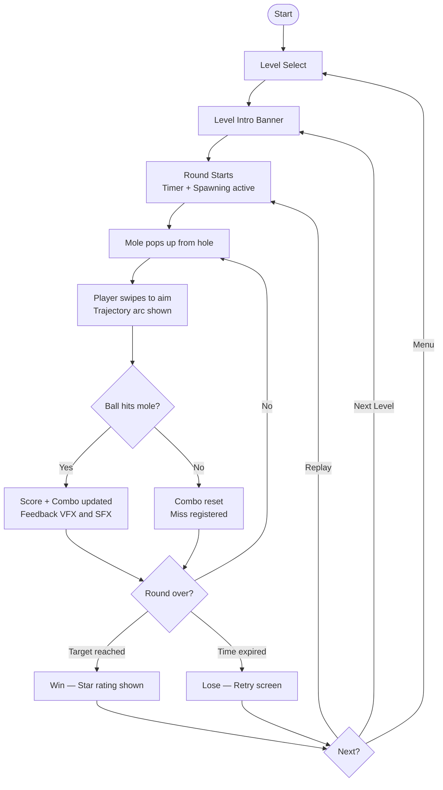

# Mole Shot

A 3D mobile arcade game built with Unity 6. The player swipes to shoot a football at moles popping out of burrows on a football field. Hit the target count before the timer runs out to clear the level.

**Engine:** Unity 6000.5.5f1  
**Platform:** Android (API 26+)  
**Render Pipeline:** Universal Render Pipeline (URP)  
**Version:** 0.1.0  
**Author:** Bhargav M — bhargav.m23@iiits.in, IIIT Sri City

---

## Setup

```bash
git clone https://github.com/bhargavm-iiits/Mole-Shooting-Game.git
```

Open in Unity Hub. First launch will auto-import all packages.

To build: **File → Build Settings → Android → Switch Platform → Build**  
Scripting backend must be set to **IL2CPP** in Player Settings.

---

## Gameplay

| Level | Duration | Target Hits | Notes |
|-------|----------|-------------|-------|
| 1 | 60 s | 10 | Slower spawn, easier timing |
| 2 | 90 s | 15 | Faster moles, tighter windows |
| 3 | 120 s | 20 | High spawn rate, frequent fast moles |

- **Swipe** to aim and release to fire the ball
- Chain hits without missing to build a **combo multiplier** (up to 3×)
- Fast moles score 2 pts; normal moles score 1 pt
- Missing a shot resets the combo
- Reach the hit target → Win (1–3 stars) | Timer expires → Retry

---

## Game Flow



---

## Project Structure

```
Football_mole/
├── Assets/
│   ├── Game Assets/        3D models — football, field, mole, cone
│   ├── MoleShot/
│   │   ├── Art/            Generated sprites and materials
│   │   ├── Config/         MoleShotConfig and LevelDefinition assets
│   │   ├── Prefabs/        Ball, Hole, HUD, Crowd prefabs
│   │   ├── Scripts/        All runtime C# scripts
│   │   │   └── Editor/     Build, playtest and recorder tools
│   │   └── Tests/          NUnit tests for ShotSolver
│   ├── Scenes/
│   │   └── SampleScene.unity
│   └── Settings/           URP pipeline assets (Mobile + PC)
├── APK/
│   └── MoleShooting.apk    Pre-built Android release
├── Packages/
└── ProjectSettings/
```

---

## Key Scripts

| Script | Role |
|--------|------|
| `RoundManager.cs` | Central state machine — game flow, timer, scoring, spawning |
| `ShotController.cs` | Connects swipe input → trajectory solver → ball launch |
| `ShotSolver.cs` | Calculates launch velocity for a given target position |
| `BallController.cs` | Rigidbody ball — launch, out-of-bounds detection, reset |
| `SwipeInput.cs` | Input System adapter — raises aim and release events |
| `TrajectoryPreview.cs` | Renders the dotted arc during the aim phase |
| `HoleController.cs` | Per-burrow mole spawn and despawn animation |
| `MoleHitbox.cs` | Collision trigger — reports valid hits to RoundManager |
| `HudController.cs` | In-game UI — score, timer, combo, result screen |
| `FeedbackController.cs` | Hit/miss particle effects and score popups |
| `AudioFeedback.cs` | SFX routing for all game events |
| `MoleShotConfig.cs` | Master ScriptableObject — all gameplay tunables |
| `AutoPlayer.cs` | AI bot for automated shot accuracy playtesting |

---

## Installing the APK

Pre-built APK is at `APK/MoleShooting.apk`.

1. Enable **Install unknown apps** in Android Settings → Apps
2. Transfer the APK to your device
3. Tap the file and install

Requires Android 8.0 (API 26) or higher.

---

## Running Tests

**Window → General → Test Runner → Edit Mode → Run All**

`ShotSolverTests` validates trajectory calculations against known target positions and gravity values.

---

## Dependencies

| Package | Version |
|---------|---------|
| Universal Render Pipeline | 17.5.0 |
| Input System | 1.19.0 |
| glTFast | 6.21.0 |
| Unity Recorder | 5.1.8 |
| Test Framework | 1.7.0 |
| AI Navigation | 2.0.14 |
